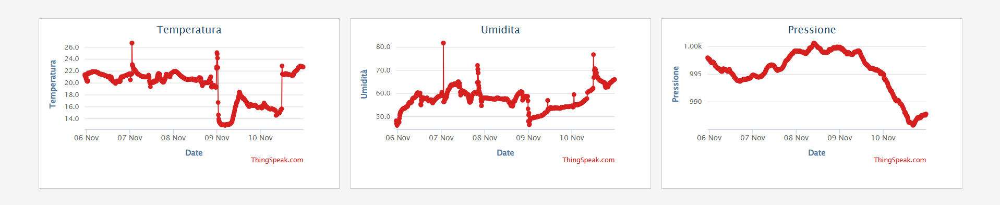
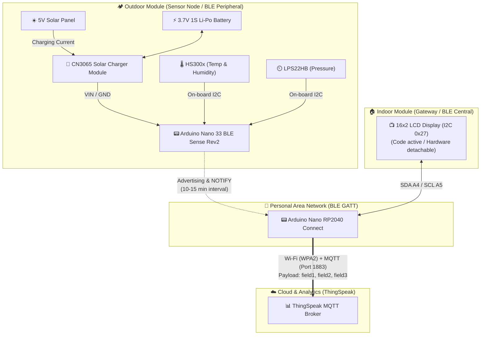
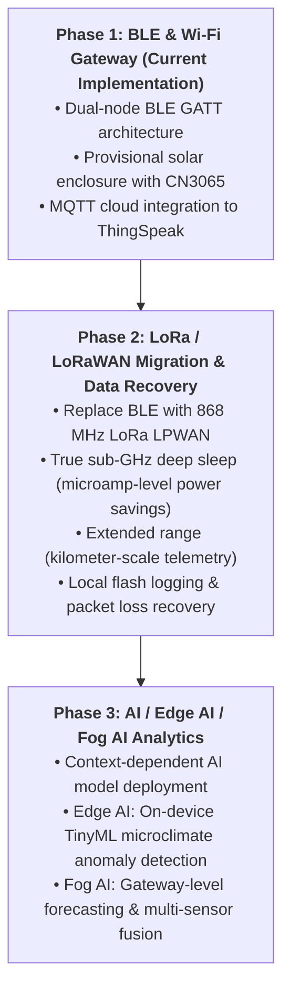

# 🌤️ IoT Weather Station (BLE & MQTT) — Phase 1

A two-node **IoT Weather Station** prototype based on Arduino microcontrollers, featuring a two-tier communication architecture (**Bluetooth Low Energy** for short-range sensor data acquisition and **MQTT via Wi-Fi** for cloud offloading), powered by a self-sustaining solar energy harvesting system housed inside a provisional outdoor enclosure.

This repository contains **Phase 1** of a Computer Engineering bachelor thesis project focused on microclimate monitoring, embedded system integration, power consumption evaluation, and laying the groundwork for long-range LPWAN (LoRa) and intelligence at the edge (Edge AI / Fog AI).

## 📸 Gallery

| Microcontroller Modules | Provisional Outdoor Enclosure | Enclosure Internal Assembly |
| :---: | :---: | :---: |
|  |  |  |
| *Arduino Nano 33 BLE Sense Rev2 & Nano RP2040 Connect* | *Provisional weatherproof enclosure with 5V solar panel* | *Internal power management setup (CN3065 charger & Li-Po)* |

| ThingSpeak Cloud Dashboard |
| :---: |
|  |
| *Time-series analytics on ThingSpeak (Temperature, Humidity, Pressure)* |

> 📌 **Note on Display Hardware:** The 16x2 I2C LCD screen is currently detached from the physical setup shown in the hardware photo above. However, full display initialization, update routines, and notification status logic are fully implemented and driven by the indoor gateway firmware (`Modulo_Interno.ino`).

---

## 🏗️ System Architecture

The system is split into two complementary hardware units, separating low-power **environmental sensing** from **gateway processing and cloud connectivity**.



### 1. Outdoor Module (BLE Peripheral / Sensor Node)

* **Hardware**: Arduino Nano 33 BLE Sense Rev2 (nRF52840 @ 64 MHz, ARM Cortex-M4F).
* **Active Sensors**: On-board `HS300x` (Temperature & Relative Humidity) and `LPS22HB` (Barometric Pressure).
* **Enclosure & Power Sub-system**: Housed inside a **provisional 3D/weatherproof enclosure** equipped with a self-sustaining power system:
  * 5V monocrystalline solar panel integrated into the chassis.
  * `CN3065` solar charge manager module.
  * 1S 3.7V Li-Po battery.
* **Operational Logic**:
  1. Boots up and initializes BLE GATT services and characteristics.
  2. Reads environmental parameters from on-board I2C sensors.
  3. Updates GATT characteristic values and sends `NOTIFY` signals to connected central devices.

### 2. Indoor Module (BLE Central / Gateway)

* **Hardware**: Arduino Nano RP2040 Connect (Raspberry Pi RP2040 dual-core @ 133 MHz, u-blox NINA-W102 Wi-Fi/BT module).
* **Display Output**: 16x2 LCD screen with I2C backpack (PCF8574 chip, address `0x27`).
* **Operational Logic**:
  1. Initializes Wi-Fi interface and connects to the ThingSpeak MQTT broker.
  2. Scans for BLE advertising packets matching device name `"StazioneMeteo"`.
  3. Connects and subscribes to notifications for Temperature, Humidity, and Pressure.
  4. Upon receiving new notifications, updates the local LCD display and publishes formatted MQTT payloads (`field1=temp&field2=umid&field3=pres`).

---

## ⚡ Schematics & Wiring

### 1. Outdoor Power Sub-system (Solar Harvesting & Battery Charger)

```text
[ 5V Solar Panel ] ──(+)──> [ CN3065 SOLAR+ ]
                    ──(-)──> [ CN3065 SOLAR- ]

[ 3.7V Li-Po Battery ] ──(+)──> [ CN3065 BAT+ ]
                       ──(-)──> [ CN3065 BAT- ]

[ CN3065 SYS+ ] ──[ ON/OFF Switch ]──> [ Arduino Nano 33 BLE - VIN ]
[ CN3065 SYS- ] ────────────────────> [ Arduino Nano 33 BLE - GND ]
```

> ⚠️ **Electrical Safety Note:** The Li-Po cell must feature an integrated Protection Circuit Module (PCM/BMS) to prevent deep discharge below 3.0V.

### 2. Indoor LCD Wiring (I2C Interface)

| I2C Backpack Pin | Arduino Nano RP2040 Connect Pin | Function / Logic Level |
| :--- | :--- | :--- |
| **GND / VSS** | **GND** | Ground reference |
| **VCC / VDD** | **3V3** *(or VUSB 5V with bridge)* | Power Supply (3.3V) |
| **SDA** | **A4** | I2C Data Line |
| **SCL** | **A5** | I2C Clock Line |

---

## 💻 Data Model & Communication Protocol

### BLE GATT Service & Characteristics UUIDs

* **Service UUID**: `19B10000-E8F2-537E-4F6C-D104768A1214`
  * **Temperature Characteristic**: `19B10001-E8F2-537E-4F6C-D104768A1214` (`BLERead` | `BLENotify`)
  * **Humidity Characteristic**: `19B10002-E8F2-537E-4F6C-D104768A1214` (`BLERead` | `BLENotify`)
  * **Pressure Characteristic**: `19B10003-E8F2-537E-4F6C-D104768A1214` (`BLERead` | `BLENotify`)

### MQTT Topic & Payload (ThingSpeak)

* **Broker**: `mqtt3.thingspeak.com` (Port `1883`)
* **Topic**: `channels/<SECRET_ID_CHANNEL>/publish`
* **Payload Format**: `field1=<TEMP>&field2=<HUMID>&field3=<PRESS>`

---

## 🛠️ Setup & Configuration

### Repository Directory Layout

```text
Weather-Station-IoT-v1/
├── Modulo_Esterno.ino
├── Modulo_Interno.ino
├── secrets_template.h
├── images/
│   ├── moduli.jpeg
│   ├── caseA.jpeg
│   ├── caseB.jpeg
│   └── dashboard.png
└── README.md
```

### Arduino IDE Folder Requirements

Because the `.ino` files are stored at the repository root, perform these steps before compiling in Arduino IDE:

1. Create a dedicated folder matching each sketch name (e.g., `Modulo_Esterno/` for `Modulo_Esterno.ino` and `Modulo_Interno/` for `Modulo_Interno.ino`).
2. Move `secrets_template.h` into the `Modulo_Interno/` directory alongside `Modulo_Interno.ino`.
3. Rename `secrets_template.h` to `secrets.h` and provide your credentials:

```cpp
#define SECRET_SSID "YOUR_WIFI_SSID"
#define SECRET_PASS "YOUR_WIFI_PASSWORD"

#define SECRET_MQTT_CLIENT_ID "THINGSPEAK_MQTT_CLIENT_ID"
#define SECRET_MQTT_USER      "THINGSPEAK_MQTT_USERNAME"
#define SECRET_PASS_MQTT      "THINGSPEAK_MQTT_PASSWORD"

#define SECRET_ID_CHANNEL     3410719UL  // ThingSpeak Channel ID
```

---

## 🚀 System Limitations & Multi-Phase Roadmap

### Current Phase 1 Limitations

1. **Bluetooth Power Overhead in Sleep Mode**: Even when placing the Outdoor MCU core into low-power sleep states, the **Bluetooth radio stack remains continuously active** to sustain advertising or GATT connection states. This persistent radio activity prevents deep microampere-level energy savings.
2. **Coverage & Attenuation**: The 2.4 GHz BLE signal experiences rapid RF attenuation through walls, restricting node-to-gateway distances to 10–15 meters.
3. **Infrastructure Dependence**: The indoor gateway requires a local Wi-Fi network to publish data to ThingSpeak.

### 🗺️ Multi-Phase Roadmap



#### 📍 Phase 2: LoRa LPWAN Migration & Long-Range Data Recovery
* **Transition to 868 MHz LoRa / LoRaWAN**: Replacing BLE with sub-GHz LoRa modules (e.g., SX1262 / Heltec nodes) will eliminate continuous radio activity, allowing the outdoor node to enter complete deep-sleep mode between telemetry bursts.
* **Extended Range**: Scale communication range from meters to kilometers, making off-grid deployments in open fields feasible.
* **Reliable Data Recovery**: Implement flash memory logging and data re-transmission protocols to recover lost telemetry packets after network disconnections.

#### 📍 Phase 3: AI, Edge AI, and Fog AI Integration
Depending on the deployment context and infrastructure capacity:
* **Edge AI (TinyML on Sensor Nodes)**: Deploy lightweight neural networks directly on the outdoor microcontroller for on-device anomaly detection, adaptive sampling intervals, and sensor drift compensation.
* **Fog AI (Gateway-level Intelligence)**: Utilize edge/fog gateways to run localized microclimate forecasting models, multi-station data fusion, and early weather alerts prior to cloud aggregation.

---

## 📜 License & Author

* **Author:** Federico Secciani
* **Repository:** [GitHub Profile](https://github.com/secciax)
* **License:** This project is licensed under the [MIT License](LICENSE).
